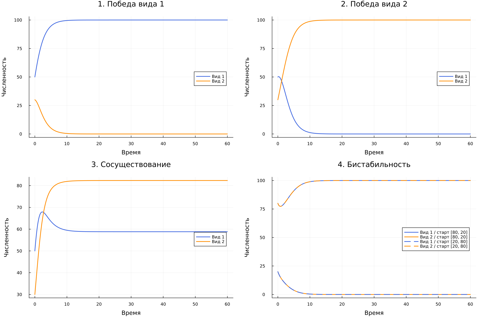
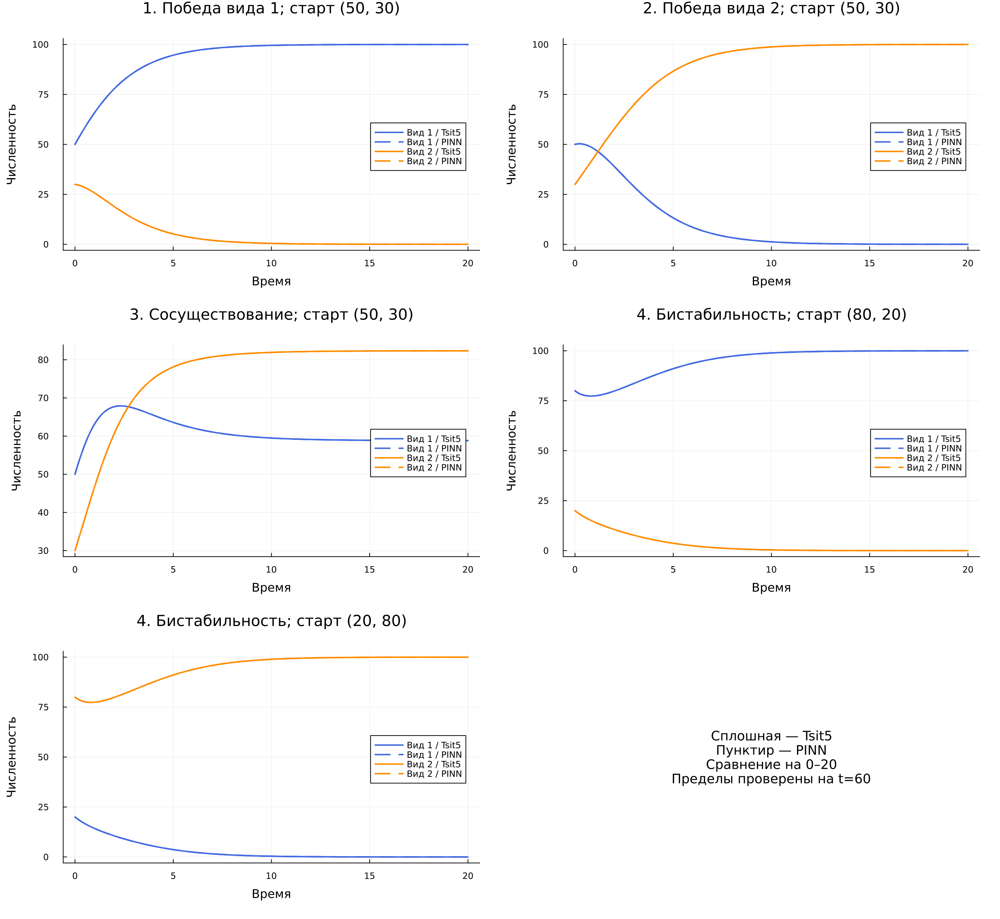
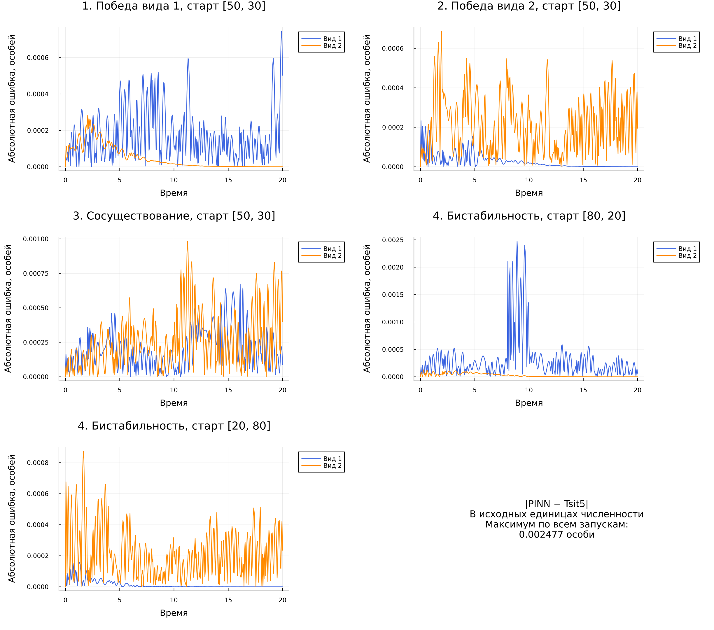
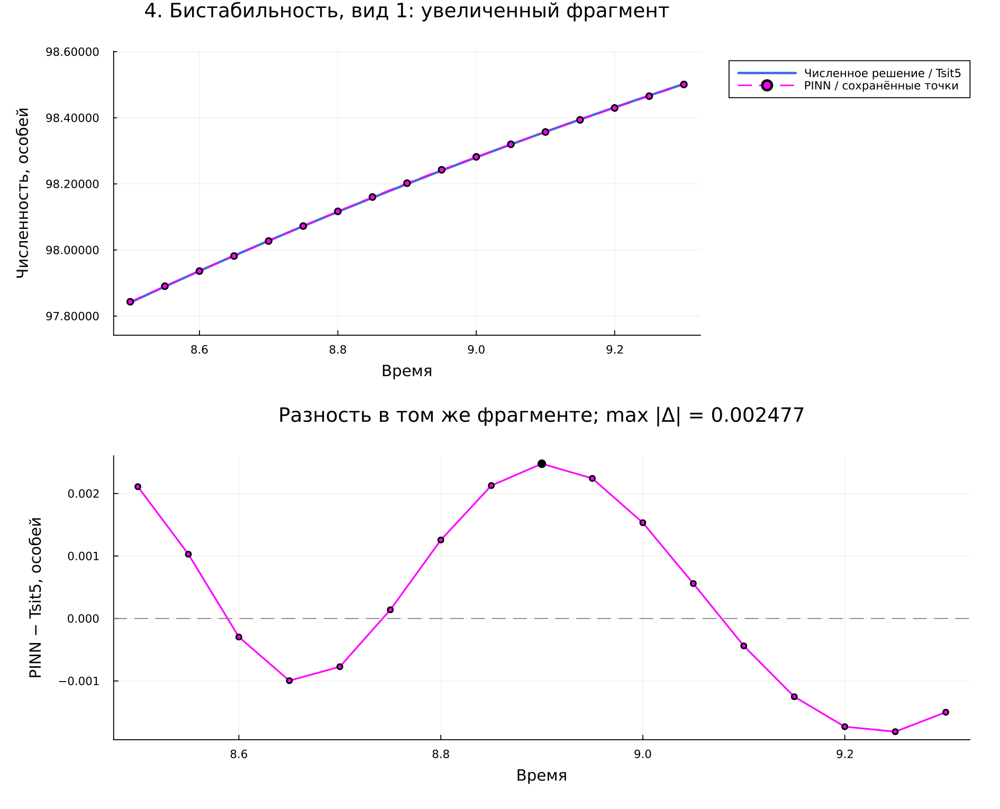

# Программная реализация и вычислительные эксперименты {#sec-ch3}

В главе представлена программная реализация классической модели межвидовой конкуренции и вычислительный эксперимент PINN для системы обыкновенных дифференциальных уравнений. Пространственная модель будет исследована на следующих этапах работы.

## Выбор инструментальных средств

Расчёты выполнены на языке Julia. Для интегрирования системы используется библиотека OrdinaryDiffEq.jl и явный адаптивный метод Рунге--Кутты Цитораса `Tsit5` порядка 5(4). PINN реализована алгоритмом `NNODE` библиотеки NeuralPDE.jl, архитектура сети задаётся средствами Lux.jl, а оптимизация выполняется методом BFGS из OptimizationOptimJL.jl. Интерактивный вычислительный протокол оформлен как Pluto-блокнот. Графики построены средствами Plots.jl.

Классический эксперимент находится в `code/ode/competition_model.jl`, а воспроизводимый Pluto-блокнот --- в `code/pluto/competition_pinn.jl`. Для повторного запуска закреплены Julia 1.13.3, Pluto 1.1.0, NeuralPDE 7.5.0, Lux 1.31.5, OrdinaryDiffEq 7.8.1, OptimizationOptimJL 0.4.23 и Plots 1.41.7. Точные зависимости сохранены в файлах `Project.toml` и `Manifest.toml`.

Вычислительный эксперимент включает:

1. автоматическую классификацию режима по двум пороговым неравенствам;
2. вычисление аналитических положений равновесия;
3. оценку устойчивости равновесий по собственным значениям матрицы Якоби;
4. численное решение для нескольких начальных условий;
5. проверку неотрицательности решения и сходимости к теоретически ожидаемому равновесию;
6. построение временных графиков и фазовых портретов.

## Параметры вычислительных экспериментов

Для трёх режимов использованы наборы параметров, приведённые в таблице @tbl-regime-parameters. Скорости роста во всех экспериментах равны $r_1=r_2=1$.

| Режим | $K_1$ | $K_2$ | $\alpha_{12}$ | $\alpha_{21}$ | Ожидаемый предел |
|---|---:|---:|---:|---:|---|
| Сосуществование | 100 | 100 | 0,5 | 0,3 | $E^*$ |
| Вытеснение | 100 | 80 | 0,4 | 1,5 | $E_1$ |
| Бистабильность | 100 | 100 | 1,5 | 1,5 | $E_1$ или $E_2$ |

: Параметры трёх режимов конкуренции {#tbl-regime-parameters}

Условия режимов проверяются отдельно для каждого коэффициента. Для сосуществования необходимы неравенства $\alpha_{12}<K_1/K_2$ и $\alpha_{21}<K_2/K_1$. Для бистабильности направления обоих неравенств меняются на противоположные. Условие только на произведение $\alpha_{12}\alpha_{21}$ не используется как достаточный критерий.

## Положения равновесия и их устойчивость

Матрица Якоби системы вычисляется в каждой аналитической стационарной точке. Точка считается устойчивой, если действительные части обоих собственных значений отрицательны. Если собственные значения имеют действительные части разных знаков, равновесие является седловым.

| Режим | Устойчивые равновесия | Неустойчивые и седловые точки |
|---|---|---|
| Сосуществование | $E^*=(58{,}8235;\ 82{,}3529)$ | $E_0$ неустойчиво; $E_1$ и $E_2$ --- седла |
| Вытеснение | $E_1=(100;\ 0)$ | $E_0$ неустойчиво; $E_2=(0;\ 80)$ --- седло |
| Бистабильность | $E_1=(100;\ 0)$ и $E_2=(0;\ 100)$ | $E_0$ неустойчиво; $E^*=(40;\ 40)$ --- седло |

: Результаты анализа устойчивости равновесий {#tbl-equilibria-results}

## Устойчивое сосуществование

Для всех четырёх проверенных начальных условий численное решение сходится к одной внутренней точке $E^*=(58{,}8235;\ 82{,}3529)$. Максимальное расстояние между конечным состоянием при $t=30$ и аналитическим равновесием среди рассмотренных траекторий не превышает $7{,}3\cdot10^{-4}$.

{#fig-coexistence-time width=100%}

Фазовый портрет на рисунке @fig-coexistence-phase показывает, что траектории из различных частей положительного квадранта сходятся к одной устойчивой внутренней точке.

{#fig-coexistence-phase width=88%}

## Конкурентное вытеснение

При $\alpha_{12}=0{,}4$ и $\alpha_{21}=1{,}5$ устойчивой является граничная точка $E_1=(100;\ 0)$. Во всех четырёх экспериментах, включая начальное условие $N_1(0)=20$, $N_2(0)=70$, первый вид вытесняет второй. Численный результат совпадает с теоретическим прогнозом и не зависит от выбранного положительного начального условия.

{#fig-exclusion-time width=100%}

{#fig-exclusion-phase width=88%}

## Бистабильность

В симметричном случае $K_1=K_2=100$ и $\alpha_{12}=\alpha_{21}=1{,}5$ граничные точки $E_1$ и $E_2$ устойчивы, а внутренняя точка $E^*=(40;\ 40)$ является седлом. Начальные условия $(80;20)$ и $(65;35)$ приводят к равновесию $E_1$, тогда как условия $(20;80)$ и $(35;65)$ приводят к $E_2$.

{#fig-bistability-time width=100%}

В выбранном симметричном примере сепаратрисой является прямая $N_1=N_2$. Она разделяет области притяжения двух устойчивых граничных равновесий. Это частный симметричный случай: для произвольных параметров сепаратриса не обязана совпадать с прямой равных численностей.

{#fig-bistability-phase width=88%}

```{=latex}
\clearpage
```

## Решение ОДУ методом PINN в Pluto

### Схема обучения

Для нейросетевого решения использован алгоритм `NNODE` библиотеки NeuralPDE.jl [@NeuralPDEDocsNNODE]. Первоначальная попытка обучать одну сеть сразу на всём интервале давала неудовлетворительное приближение на его дальней части. Поэтому в итоговом эксперименте интервал $0\leq t\leq20$ разбит на десять последовательных окон длиной 2. Конечное состояние каждого окна становится начальным условием следующего.

Неотрицательность численностей обеспечивается логарифмической заменой (@eq-log-transform), а loss вычисляется по невязкам (@eq-competition-residuals)--(@eq-competition-loss). Использована полносвязная сеть $1$--$16$--$16$--$2$ с функцией активации `tanh` и фиксированной инициализацией `seed = 42`. На каждом окне применяется BFGS, стратегия `GridTraining(0.05)` и не более 600 итераций.

Если первая схема не удовлетворяет критерию точности, программой предусмотрена повторная попытка: окно сокращается до 1, фиксированная сетка заменяется адаптивным интегрированием невязки, а лимит увеличивается до 1000 итераций. В выполненном эксперименте все пять траекторий прошли первую схему, поэтому резервный вариант фактически не запускался.

### Независимая проверка точности

При обучении значения `Tsit5` не входят в функцию потерь. После обучения PINN сравнивается с эталонной траекторией на сетке с шагом $0{,}05$. Эталон `Tsit5` дополнительно сверяется с решением `Vern9`; максимальное нормированное различие двух численных методов должно быть меньше $10^{-7}$.

Используются две метрики:

$$
\varepsilon_{\max}=\max_{i,j}\frac{|N_i^{\mathrm{PINN}}(t_j)-N_i^{\mathrm{Tsit5}}(t_j)|}{K_i},
$$ {#eq-pinn-max-error}

$$
\varepsilon_{L_2}=\frac{\|N^{\mathrm{PINN}}-N^{\mathrm{Tsit5}}\|_2}{\|N^{\mathrm{Tsit5}}\|_2}.
$$ {#eq-pinn-l2-error}

Критерий принятия результата имеет вид $\varepsilon_{\max}<0{,}01$ при конечных положительных значениях обеих численностей. В @tbl-pinn-results приведены результаты контрольного запуска 10 ноября 2026 г.

| Исход и начальное условие | $\varepsilon_{\max}$ | $\varepsilon_{L_2}$ |
|---|---:|---:|
| Победа вида 1; $(50;30)$ | $7{,}456\cdot10^{-6}$ | $2{,}508\cdot10^{-6}$ |
| Победа вида 2; $(50;30)$ | $6{,}873\cdot10^{-6}$ | $2{,}820\cdot10^{-6}$ |
| Сосуществование; $(50;30)$ | $9{,}839\cdot10^{-6}$ | $4{,}182\cdot10^{-6}$ |
| Бистабильность; $(80;20)$ | $2{,}477\cdot10^{-5}$ | $5{,}424\cdot10^{-6}$ |
| Бистабильность; $(20;80)$ | $8{,}745\cdot10^{-6}$ | $2{,}823\cdot10^{-6}$ |

: Ошибки PINN относительно Tsit5 на интервале $[0;20]$ {#tbl-pinn-results}

Наибольшая относительная $L_2$-ошибка равна $5{,}424\cdot10^{-6}$, или приблизительно $0{,}000542\%$. Наибольшая точечная ошибка, нормированная на ёмкость среды, равна $2{,}477\cdot10^{-5}$; при $K_i=100$ это соответствует расхождению около $0{,}00248$ единицы численности. Поэтому на графике общего масштаба сплошные линии `Tsit5` и пунктирные линии PINN практически накладываются.

Времена обучения пяти траекторий составили соответственно 76,2; 47,3; 47,1; 50,6 и 43,6 с. Все пять результатов получены первой схемой; повторное обучение не потребовалось.

{#fig-four-outcomes width=100%}

{#fig-pinn-comparison width=100%}

Для количественного чтения результата построен отдельный график абсолютной ошибки. Значение по вертикальной оси показывает $|N_i^{\mathrm{PINN}}-N_i^{\mathrm{Tsit5}}|$ в исходных единицах численности, а не значение loss.

{#fig-pinn-absolute-error width=100%}

На увеличенном фрагменте `Tsit5` показан синей линией, PINN --- пурпурным пунктиром с маркерами. Нижняя панель содержит знаковую разность: положительное значение означает завышение прогноза PINN, отрицательное --- занижение.

{#fig-pinn-zoom width=88%}

Приведённые времена относятся к одному последовательному запуску на конкретном компьютере и не являются аппаратно-независимым бенчмарком. Первый сценарий включает дополнительные накладные расходы первого обращения к нейросетевому решателю. Кроме того, полный интервал пока проверен для одной инициализации сети (`seed = 42`); для оценки устойчивости PINN необходимо повторить эксперимент с несколькими значениями `seed`.

## Выводы по этапу ОДУ {.unnumbered}

Решения `Tsit5` для трёх математических режимов сохраняют неотрицательность численностей и сходятся к равновесиям, найденным при аналитическом исследовании. Для двух направлений вытеснения, сосуществования и двух исходов бистабильности оконная PINN на интервале $[0;20]$ прошла установленный критерий точности без повторного обучения. Максимальная относительная $L_2$-ошибка в контрольном запуске составила $5{,}424\cdot10^{-6}$. Следующий этап проверки должен включать несколько случайных инициализаций и единый протокол измерения времени после прогрева среды.
