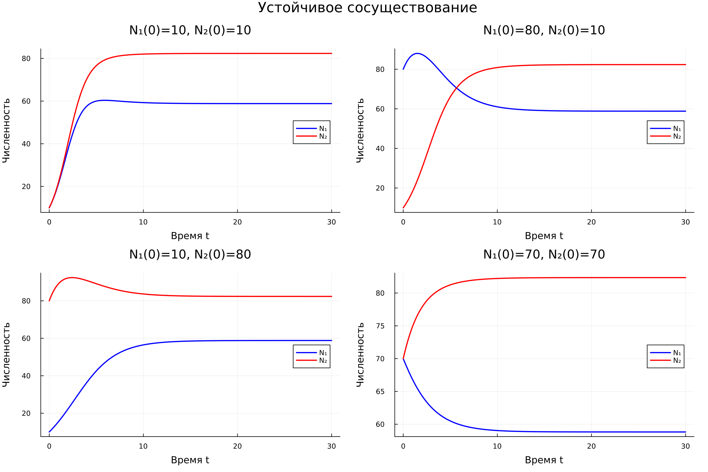
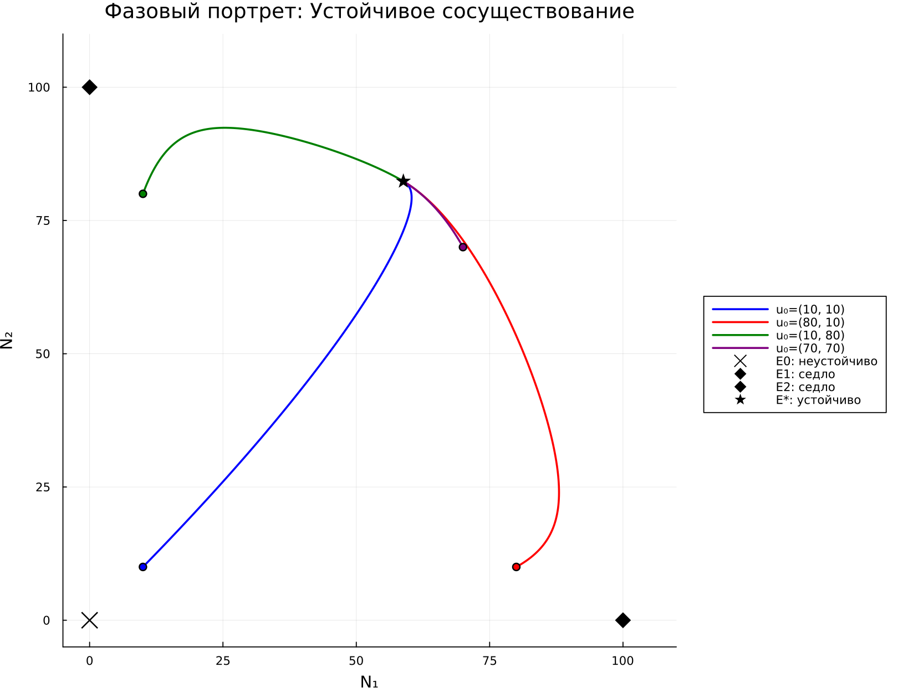
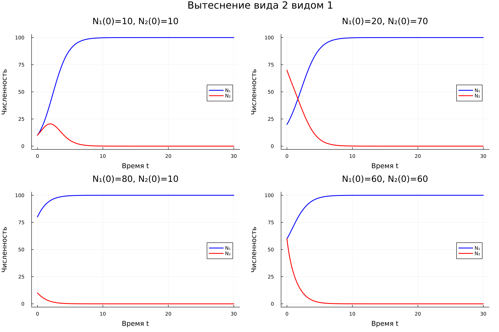
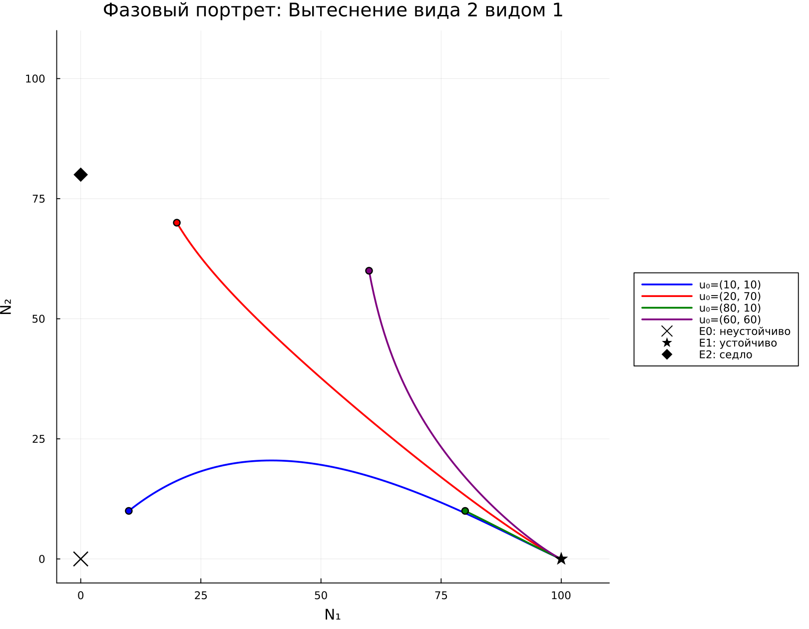
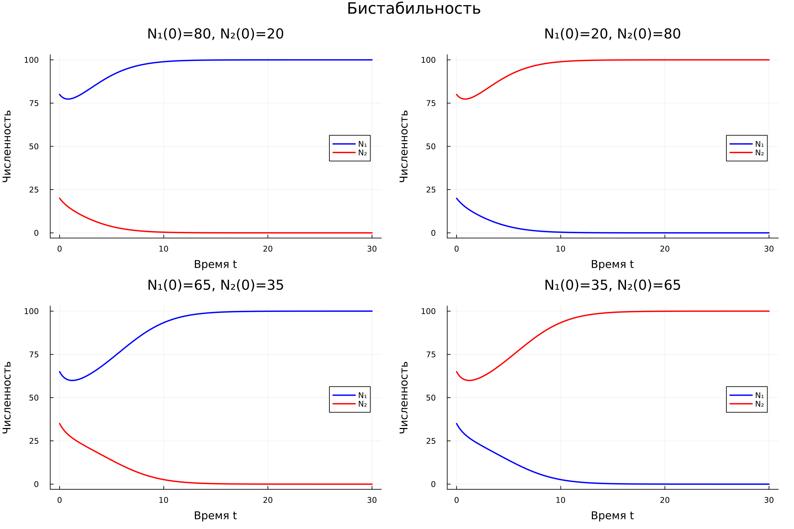
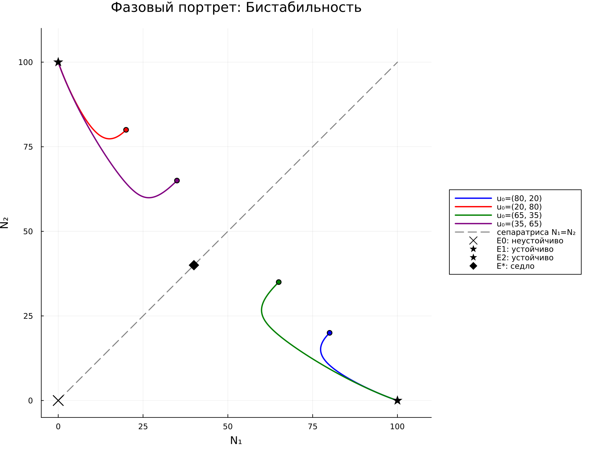

# Программная реализация и вычислительные эксперименты {#sec-ch3}

В главе представлена программная реализация классической модели межвидовой конкуренции и первые вычислительные эксперименты, выполненные в рамках ноябрьского этапа исследования. На данном этапе рассматривается только система обыкновенных дифференциальных уравнений. Нейросетевое решение и пространственная модель будут исследованы на следующих этапах работы.

## Выбор инструментальных средств

Расчёты выполнены на языке Julia с применением библиотеки OrdinaryDiffEq.jl. Для интегрирования системы используется явный адаптивный метод Рунге--Кутты Цитораса `Tsit5` порядка 5(4). Графики построены средствами Plots.jl. Исходный код эксперимента находится в файле `code/ode/competition_model.jl`.

Вычислительный эксперимент включает:

1. автоматическую классификацию режима по двум пороговым неравенствам;
2. вычисление аналитических положений равновесия;
3. оценку устойчивости равновесий по собственным значениям матрицы Якоби;
4. численное решение для нескольких начальных условий;
5. проверку неотрицательности решения и сходимости к теоретически ожидаемому равновесию;
6. построение временных графиков и фазовых портретов.

## Параметры вычислительных экспериментов

Для трёх режимов использованы наборы параметров, приведённые в таблице @tbl-regime-parameters. Скорости роста во всех экспериментах равны $r_1=r_2=1$.

| Режим | $K_1$ | $K_2$ | $\alpha_{12}$ | $\alpha_{21}$ | Теоретический исход |
|---|---:|---:|---:|---:|---|
| Сосуществование | 100 | 100 | 0,5 | 0,3 | Устойчиво внутреннее равновесие $E^*$ |
| Вытеснение | 100 | 80 | 0,4 | 1,5 | Вид 1 вытесняет вид 2 |
| Бистабильность | 100 | 100 | 1,5 | 1,5 | Устойчивы $E_1$ и $E_2$, исход зависит от начальных условий |

: Параметры трёх режимов конкуренции {#tbl-regime-parameters}

Условия режимов проверяются отдельно для каждого коэффициента. Для сосуществования необходимы неравенства $\alpha_{12}<K_1/K_2$ и $\alpha_{21}<K_2/K_1$. Для бистабильности направления обоих неравенств меняются на противоположные. Условие только на произведение $\alpha_{12}\alpha_{21}$ не используется как достаточный критерий.

## Положения равновесия и их устойчивость

Матрица Якоби системы вычисляется в каждой аналитической стационарной точке. Точка считается устойчивой, если действительные части обоих собственных значений отрицательны. Если собственные значения имеют действительные части разных знаков, равновесие является седловым.

| Режим | Устойчивые равновесия | Неустойчивые и седловые точки |
|---|---|---|
| Сосуществование | $E^*=(58{,}8235;\ 82{,}3529)$ | $E_0$ неустойчиво; $E_1$ и $E_2$ --- седла |
| Вытеснение | $E_1=(100;\ 0)$ | $E_0$ неустойчиво; $E_2=(0;\ 80)$ --- седло |
| Бистабильность | $E_1=(100;\ 0)$ и $E_2=(0;\ 100)$ | $E_0$ неустойчиво; $E^*=(40;\ 40)$ --- седло |

: Результаты анализа устойчивости равновесий {#tbl-equilibria-results}

## Устойчивое сосуществование

Для всех четырёх проверенных начальных условий численное решение сходится к одной внутренней точке $E^*=(58{,}8235;\ 82{,}3529)$. Максимальное расстояние между конечным состоянием при $t=30$ и аналитическим равновесием среди рассмотренных траекторий не превышает $7{,}3\cdot10^{-4}$.

{#fig-coexistence-time width=100%}

Фазовый портрет на рисунке @fig-coexistence-phase показывает, что траектории из различных частей положительного квадранта сходятся к одной устойчивой внутренней точке.

{#fig-coexistence-phase width=88%}

## Конкурентное вытеснение

При $\alpha_{12}=0{,}4$ и $\alpha_{21}=1{,}5$ устойчивой является граничная точка $E_1=(100;\ 0)$. Во всех четырёх экспериментах, включая начальное условие $N_1(0)=20$, $N_2(0)=70$, первый вид вытесняет второй. Численный результат совпадает с теоретическим прогнозом и не зависит от выбранного положительного начального условия.

{#fig-exclusion-time width=100%}

{#fig-exclusion-phase width=88%}

## Бистабильность

В симметричном случае $K_1=K_2=100$ и $\alpha_{12}=\alpha_{21}=1{,}5$ граничные точки $E_1$ и $E_2$ устойчивы, а внутренняя точка $E^*=(40;\ 40)$ является седлом. Начальные условия $(80;20)$ и $(65;35)$ приводят к равновесию $E_1$, тогда как условия $(20;80)$ и $(35;65)$ приводят к $E_2$.

{#fig-bistability-time width=100%}

В выбранном симметричном примере сепаратрисой является прямая $N_1=N_2$. Она разделяет области притяжения двух устойчивых граничных равновесий. Это частный симметричный случай: для произвольных параметров сепаратриса не обязана совпадать с прямой равных численностей.

{#fig-bistability-phase width=88%}

## Выводы по ноябрьскому этапу {.unnumbered}

Классическая модель конкуренции реализована и проверена для трёх основных режимов. Численные решения `Tsit5` сохраняют неотрицательность численностей и сходятся к равновесиям, предсказанным аналитическим исследованием. Полученные графики и фазовые портреты могут использоваться как опорные результаты при последующем сравнении с NNODE. На следующем этапе необходимо провести повторяемые эксперименты PINN для тех же параметров и начальных условий, не изменяя эталонные решения классического метода.
