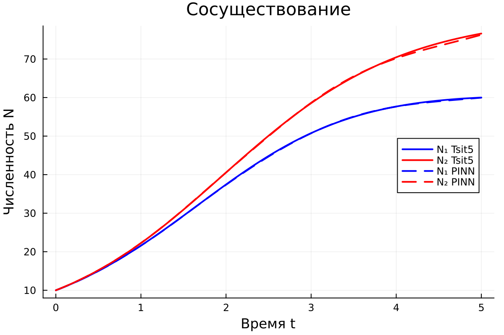

# Программная реализация и вычислительные эксперименты {#sec-ch3}

В главе представлена программная реализация классической модели межвидовой конкуренции, результаты ноябрьского этапа и предварительный эксперимент PINN для системы обыкновенных дифференциальных уравнений. Пространственная модель будет исследована на следующих этапах работы.

## Выбор инструментальных средств

Расчёты выполнены на языке Julia с применением библиотеки OrdinaryDiffEq.jl. Для интегрирования системы используется явный адаптивный метод Рунге--Кутты Цитораса `Tsit5` порядка 5(4). Графики построены средствами Plots.jl. Исходный код эксперимента находится в файле `code/ode/competition_model.jl`.

Вычислительный эксперимент включает:

1. автоматическую классификацию режима по двум пороговым неравенствам;
2. вычисление аналитических положений равновесия;
3. оценку устойчивости равновесий по собственным значениям матрицы Якоби;
4. численное решение для нескольких начальных условий;
5. проверку неотрицательности решения и сходимости к теоретически ожидаемому равновесию;
6. построение временных графиков и фазовых портретов.

## Параметры вычислительных экспериментов

Для трёх режимов использованы наборы параметров, приведённые в таблице @tbl-regime-parameters. Скорости роста во всех экспериментах равны $r_1=r_2=1$.

| Режим | $K_1$ | $K_2$ | $\alpha_{12}$ | $\alpha_{21}$ | Ожидаемый предел |
|---|---:|---:|---:|---:|---|
| Сосуществование | 100 | 100 | 0,5 | 0,3 | $E^*$ |
| Вытеснение | 100 | 80 | 0,4 | 1,5 | $E_1$ |
| Бистабильность | 100 | 100 | 1,5 | 1,5 | $E_1$ или $E_2$ |

: Параметры трёх режимов конкуренции {#tbl-regime-parameters}

Условия режимов проверяются отдельно для каждого коэффициента. Для сосуществования необходимы неравенства $\alpha_{12}<K_1/K_2$ и $\alpha_{21}<K_2/K_1$. Для бистабильности направления обоих неравенств меняются на противоположные. Условие только на произведение $\alpha_{12}\alpha_{21}$ не используется как достаточный критерий.

## Положения равновесия и их устойчивость

Матрица Якоби системы вычисляется в каждой аналитической стационарной точке. Точка считается устойчивой, если действительные части обоих собственных значений отрицательны. Если собственные значения имеют действительные части разных знаков, равновесие является седловым.

| Режим | Устойчивые равновесия | Неустойчивые и седловые точки |
|---|---|---|
| Сосуществование | $E^*=(58{,}8235;\ 82{,}3529)$ | $E_0$ неустойчиво; $E_1$ и $E_2$ --- седла |
| Вытеснение | $E_1=(100;\ 0)$ | $E_0$ неустойчиво; $E_2=(0;\ 80)$ --- седло |
| Бистабильность | $E_1=(100;\ 0)$ и $E_2=(0;\ 100)$ | $E_0$ неустойчиво; $E^*=(40;\ 40)$ --- седло |

: Результаты анализа устойчивости равновесий {#tbl-equilibria-results}

## Устойчивое сосуществование

Для всех четырёх проверенных начальных условий численное решение сходится к одной внутренней точке $E^*=(58{,}8235;\ 82{,}3529)$. Максимальное расстояние между конечным состоянием при $t=30$ и аналитическим равновесием среди рассмотренных траекторий не превышает $7{,}3\cdot10^{-4}$.

{#fig-coexistence-time width=100%}

Фазовый портрет на рисунке @fig-coexistence-phase показывает, что траектории из различных частей положительного квадранта сходятся к одной устойчивой внутренней точке.

{#fig-coexistence-phase width=88%}

## Конкурентное вытеснение

При $\alpha_{12}=0{,}4$ и $\alpha_{21}=1{,}5$ устойчивой является граничная точка $E_1=(100;\ 0)$. Во всех четырёх экспериментах, включая начальное условие $N_1(0)=20$, $N_2(0)=70$, первый вид вытесняет второй. Численный результат совпадает с теоретическим прогнозом и не зависит от выбранного положительного начального условия.

{#fig-exclusion-time width=100%}

{#fig-exclusion-phase width=88%}

## Бистабильность

В симметричном случае $K_1=K_2=100$ и $\alpha_{12}=\alpha_{21}=1{,}5$ граничные точки $E_1$ и $E_2$ устойчивы, а внутренняя точка $E^*=(40;\ 40)$ является седлом. Начальные условия $(80;20)$ и $(65;35)$ приводят к равновесию $E_1$, тогда как условия $(20;80)$ и $(35;65)$ приводят к $E_2$.

{#fig-bistability-time width=100%}

В выбранном симметричном примере сепаратрисой является прямая $N_1=N_2$. Она разделяет области притяжения двух устойчивых граничных равновесий. Это частный симметричный случай: для произвольных параметров сепаратриса не обязана совпадать с прямой равных численностей.

{#fig-bistability-phase width=88%}

```{=latex}
\clearpage
```

## Предварительное решение ОДУ методом PINN

Для нейросетевого решения использован алгоритм `NNODE` библиотеки NeuralPDE.jl [@NeuralPDEDocsNNODE]. Начальное условие в этой реализации включается в аппроксимацию решения, а обучение минимизирует невязку нормализованной системы ОДУ. Нормализация задана формулами

$$
u_1=\frac{N_1}{K_1},\qquad
u_2=\frac{N_2}{K_2},\qquad
\tau=r_1t.
$$

Использована полносвязная сеть с четырьмя скрытыми слоями по 64 нейрона и функцией активации `gelu`. Оптимизация выполнена методом Adam с шагом $0{,}01$ в течение 1000 итераций. Интервал $\tau\in[0;5]$ разбит интервальной стратегией обучения с весами $(0{,}7;0{,}2;0{,}1)$. Эталоном служит решение `Tsit5` в 101 точке с шагом сохранения $0{,}05$.

Для оценки зависимости от случайной инициализации проведены запуски с `seed` 11, 42 и 73. В таблице @tbl-pinn-results приведены усреднённые абсолютные ошибки в исходных единицах численности. Последние два столбца содержат наибольшую точечную ошибку среди всех трёх запусков.

| Режим | Средняя MAE $N_1$ | Средняя MAE $N_2$ | Наибольшая Max $N_1$ | Наибольшая Max $N_2$ |
|---|---:|---:|---:|---:|
| Сосуществование | 0,0964 | 0,0847 | 0,3944 | 0,7067 |
| Вытеснение | 0,4175 | 0,1589 | 2,0354 | 1,1307 |
| Бистабильность | 0,1271 | 0,0990 | 0,8209 | 0,3603 |

: Ошибки PINN относительно Tsit5 на интервале $[0;5]$ {#tbl-pinn-results}

Во всех девяти основных запусках число отрицательных значений, меньших $-0{,}01$, равно нулю. Наибольшая зависимость от инициализации обнаружена для режима вытеснения: при `seed = 73` средняя ошибка $N_1$ составила 1,174, тогда как при двух других инициализациях она не превышала 0,07. Поэтому единичный успешный запуск нельзя считать достаточным подтверждением качества PINN.

{#fig-pinn-coexist width=100%}

Дополнительные проверки выполнены для начального условия $(70;20)$ в режиме сосуществования и $(20;80)$ в режиме бистабильности. В первом случае MAE равны 0,085 и 0,219, во втором --- 0,121 и 0,159. Тем самым проверены обе области притяжения симметричного бистабильного режима.

Среднее время уже прогретого `Tsit5` составило менее $10^{-4}$ с, тогда как обучение PINN занимало примерно 19--47 с в зависимости от режима и включало компиляцию нейросетевого решателя в каждом отдельном процессе. Эти значения показывают вычислительные затраты текущей реализации, но не являются строгим аппаратно-независимым бенчмарком.

## Выводы по этапу ОДУ {.unnumbered}

Решения `Tsit5` для трёх режимов сохраняют неотрицательность численностей и сходятся к равновесиям, найденным при аналитическом исследовании. На интервале $[0;5]$ решение `NNODE` близко к `Tsit5`, но ошибки различаются при смене случайной инициализации сети, а обучение занимает на несколько порядков больше времени. Эти результаты относятся только к проверенному интервалу: для итогового сравнения нужны расчёты до $t=15$--$20$ и единый протокол измерения времени.
